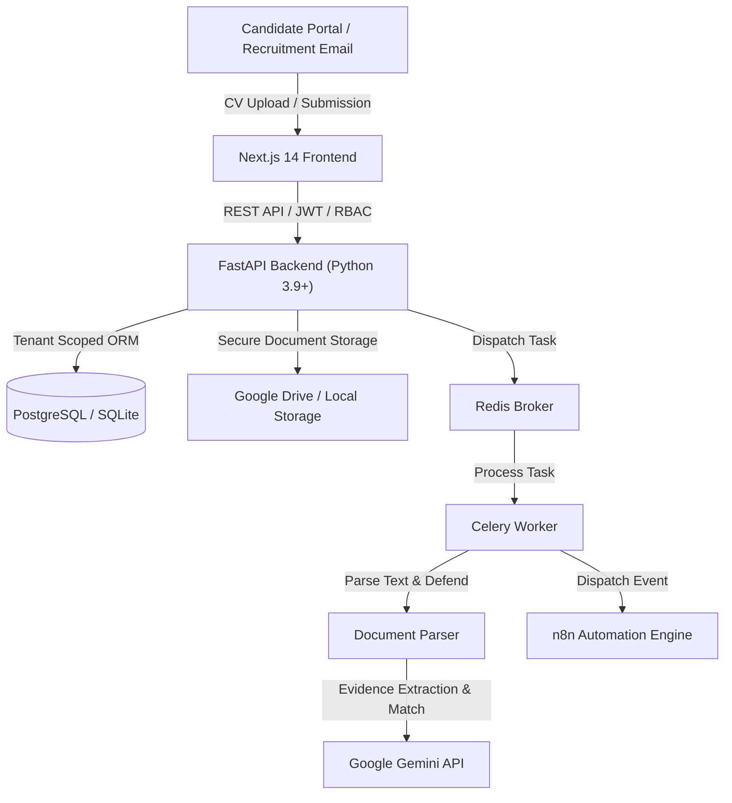

# HireFlow AI — AI-Powered Recruitment & CV Processing SaaS Platform

> **Software Requirements Specification (SRS v1.0) Implementation**  
> Evidence-based CV parsing, multi-tenant isolation, Google Gemini LLM structured extraction & job requirement assessment, Next.js frontend, and asynchronous Celery processing.

---

## 🌟 Key Features

1. **Multi-Tenant SaaS Architecture**
   - Logical organization data isolation: queries and entities scoped to `organization_id`.
   - Role-Based Access Control (RBAC): `Owner`, `Admin`, `Recruiter`, `Hiring Manager`.
   - Comprehensive audit logging (`audit_logs`) tracking significant recruiter actions.

2. **AI-Based Structured CV Extraction (Google Gemini)**
   - Extracts contact details, professional summary, skills, employment history, education, certifications, and flagged missing information.
   - Pydantic v2 structured JSON schema validation.
   - Built-in prompt-injection defense against adversarial instructions embedded in uploaded documents.

3. **Evidence-Based Job Requirement Assessment**
   - Categorizes requirements into **Essential** and **Preferred**.
   - Standardized evidence ratings: `Evidenced`, `Partially Evidenced`, `Not Found`, `Unclear`.
   - Exact CV excerpt citations and page number references.
   - **Human in the Loop**: Recruiters can review, challenge, and override AI assessment scores with full correction history.

4. **AI Recruiter Summaries**
   - Executive overview, key candidate strengths, potential gaps / areas to probe, and tailored behavioral & technical interview questions.
   - Recruiter editable with version preservation.

5. **Document Ingestion & Multi-Format Support**
   - Validates file type, MIME type, and size limits (up to 10MB).
   - Supports **PDF**, **DOCX**, and **TXT** files.
   - Pluggable storage architecture: Local Private Storage adapter + Google Drive API integration.

6. **Candidate Application Portal**
   - Public career portal (`/portal/[orgSlug]`) for any tenant organization.
   - Clean, mobile-responsive application form with CV upload and instant confirmation.

7. **Recruitment Email Intake & n8n Automation**
   - Webhook endpoint (`/api/v1/webhooks/email-intake`) receiving incoming recruitment emails with CV attachments.
   - Dispatches authenticated webhook events (`application.received`, `cv.processed`, `cv.failed`).

8. **Recruitment Analytics & Platform Superadmin**
   - Live dashboard with vacancy metrics, pipeline funnel, and document processing counters.
   - Platform superadmin portal for multi-tenant subscription tiers and usage metrics.

---

## 🏛️ System Architecture



---

## 🚀 Quick Start Guide

### Option 1: Docker Compose (Full Stack with PostgreSQL, Redis, Celery & n8n)

```bash
# 1. Clone repository
cd Hireflow

# 2. Configure environment (optional: set your GEMINI_API_KEY)
export GEMINI_API_KEY="your-gemini-api-key"

# 3. Start all services
docker compose up --build
```

Services will be available at:
- **Frontend Dashboard & Portal**: [http://localhost:3000](http://localhost:3000)
- **FastAPI Backend & Interactive Swagger Docs**: [http://localhost:8000/docs](http://localhost:8000/docs)
- **n8n Workflow Automation**: [http://localhost:5678](http://localhost:5678)

---

### Option 2: Local Development (Fast Start)

#### 1. Backend Setup (FastAPI)
```bash
cd backend

# Create virtual environment
python3 -m venv venv
source venv/bin/activate

# Install requirements
pip install -r requirements.txt

# Launch FastAPI server (auto-creates SQLite tables & seeds demo data on launch)
uvicorn app.main:app --reload --port 8000
```

#### 2. Frontend Setup (Next.js)
```bash
cd frontend

# Install node dependencies
npm install

# Start development server
npm run dev
```

Visit [http://localhost:3000](http://localhost:3000) to open the application.

---

## 🔑 Pre-Seeded Demo Accounts

The application automatically seeds a demo tenant on first run:

| Role | Email | Password | Organization |
| :--- | :--- | :--- | :--- |
| **Recruiter / Owner** | `recruiter@technova.io` | `Password123!` | TechNova Solutions (`technova`) |
| **Platform Super Admin** | `admin@hireflow.ai` | `AdminPass123!` | Global Platform Governance |

- **Public Candidate Portal**: [http://localhost:3000/portal/technova](http://localhost:3000/portal/technova)

---

## 🧪 Automated Testing

Run the automated test suite covering authentication, cross-tenant isolation, CV parsing, and AI assessment:

```bash
cd backend
source venv/bin/activate
pytest tests/ -v
```

### Verified Test Cases:
- `test_register_user` & `test_login_success`: User and tenant registration.
- `test_cross_tenant_jobs_isolation`: Confirms Org B cannot see or query Org A's jobs.
- `test_cross_tenant_candidates_isolation`: Confirms Org B cannot access Org A's candidate pool.
- `test_cross_tenant_applications_isolation`: Confirms Org B cannot see Org A's submitted applications.
- `test_create_job_with_essential_and_preferred_requirements`: Requirement categorization.
- `test_adversarial_prompt_injection_detection`: Detects malicious instructions embedded in CVs.
- `test_heuristic_job_requirement_assessment`: Validates evidence-based matching logic.

---

## 📄 API Endpoints Summary

- `POST /api/v1/auth/register` — Register user & organization
- `POST /api/v1/auth/login` — Authenticate and receive JWT
- `GET /api/v1/jobs/` — List organization vacancies
- `POST /api/v1/jobs/` — Create vacancy with essential & preferred criteria
- `GET /api/v1/jobs/portal/{org_slug}/list` — Public job listings
- `POST /api/v1/applications/portal/{org_slug}/submit` — Candidate CV submission
- `GET /api/v1/applications/` — List pipeline applications
- `GET /api/v1/applications/{id}` — Candidate dossier & AI match assessment
- `PUT /api/v1/ai/assessment/{id}/override` — Recruiter challenge & override
- `PUT /api/v1/ai/summary/{id}/edit` — Recruiter summary customization
- `POST /api/v1/webhooks/email-intake` — n8n automated email intake webhook
- `GET /api/v1/analytics/dashboard` — Executive recruitment KPIs

